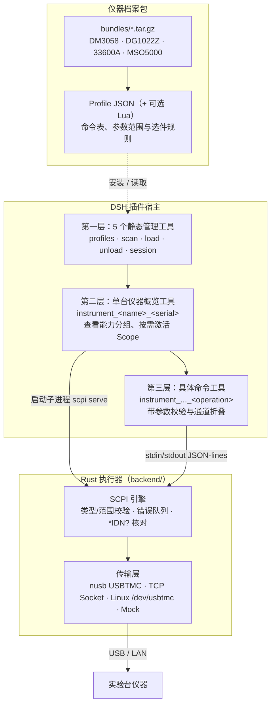

<p align="center">
  
</p>

# 电子工程师大肥鱼 · ee-fat-whale

<p align="center">
  <b>简体中文</b> | <a href="README_EN.md">English</a>
</p>

`ee-fat-whale` 是一个用于连接 SCPI 实验室仪器的 DeepSeek Harness (DSH) 插件。

如果直接让模型拼裸 SCPI 字符串，既容易写错命令名把仪器错误队列堵死，也可能因为漏关输出或写错量程损坏待测板。另外，一台示波器动辄八九百条指令，全部塞进上下文会直接占满近 20 万 tokens。

为此，插件把协议收发和工具注册拆成了两层：
- **Rust 执行器（`backend/`）**：负责 USBTMC / TCP 传输、参数类型与量程校验、SCPI 报文拼装、响应解析、错误队列轮询和输出联锁。Rust 里不写死任何具体型号的指令。
- **DSH 插件宿主（`host/`）**：管理仪器包与子进程会话，按 `basic → instrument → tools` 三层结构向模型按需注册强类型工具，不向模型暴露裸 SCPI 接口。
- **仪器档案包（`bundles/`）**：单台仪器的命令表、选件探测规则、通道数和 `safety_output` 均由独立的 Profile JSON（及可选 Lua 脚本）描述，新增仪器不需要重编 Rust。

仓库内置了 4 款常用仪器包：**Rigol DM3058**、**Rigol DG1022Z**、**Keysight 33600A** 和 **Rigol MSO5000**，可在设置页面直接安装。

---

## 主要机制

- **三层按需加载（`basic` → `instrument` → `tools`）**  
  初始只注册 5 个静态管理工具；连上仪器后只增加 1 个单台仪器的概览工具；具体命令工具等模型按能力分组（Scope）激活后才注册。
- **按功能分组（Scope）**  
  命令按 `vertical`、`waveform`、`trigger`、`measure`、`modulation` 等功能域划分，而不是按物理通道堆砌。
- **通道折叠（Channel Folding）**  
  多通道仪器的 `ch1.scale` .. `ch4.scale` 会合并为一个带 `channel: 1..4` 参数的 `vertical_scale` 工具；单通道仪器自动省略 `channel` 参数。
- **双层参数校验**  
  参数支持 `bool`、`int`、`float`、`string`、`enum`、`any` 及 `min` / `max` 约束。JS 宿主层和 Rust 执行器各做一次校验。
- **输出联锁（`safety_output`）**  
  改写信号源频率、幅度或偏置等带 `safety_output` 标记的命令时，Rust 会先关闭对应输出通道，写入成功后再重新打开；若写入失败则保持关闭。
- **选件探测**  
  加载仪器时自动查询已安装的硬件选件（含 MSO5000 `BND` 等复合选件包映射），未安装的选件命令不注册为工具。
- **手册核对与 Token 统计**  
  MSO5000 的 889 条命令已逐条核对官方编程手册（见 [audit/mso5000-audit.md](audit/mso5000-audit.md)）；4 台仪器的工具 Token 实测数据见 [audit/tool-token-usage.md](audit/tool-token-usage.md)。

---

## 内置仪器包与支持平台

| 仪器型号 | 类型 | Profile ID | 内置包 | 模拟通道 | 原始命令数 | 折叠后工具数 | 默认推荐 Scope |
| --- | --- | --- | --- | ---: | ---: | ---: | --- |
| **Rigol DM3058 / DM3058E** | 5½ 位数字万用表 | `rigol.dm3058` | `dm3058.tar.gz` | 0 | 126 | 126 | `measure` |
| **Rigol DG1022Z** | 双通道函数/任意波形发生器 | `rigol.dg1022z` | `dg1022z.tar.gz` | 2 | 382 | 255 | `waveform` |
| **Keysight 33600A / 33611A** | 波形发生器 | `keysight.33600a` | `ks33600a.tar.gz` | 1 | 382 | 252 | `waveform` |
| **Rigol MSO5000**（全选件） | 混合信号示波器 | `rigol.mso5000` | `mso5000.tar.gz` | 4 | 889 | 856 | `vertical`, `horizontal`, `trigger`, `measure` |

> MSO5000 仅启用 AWG 选件时为 614 个逻辑工具，9 个选件全开时为 856 个。

预编译发行包覆盖以下 64 位平台：

| 操作系统 | 架构 | 二进制路径 | CI 镜像 |
| --- | --- | --- | --- |
| Linux | x86_64 | `bin/scpi` | `ubuntu-22.04` |
| Linux | ARM64 | `bin/scpi` | `ubuntu-22.04-arm` |
| macOS | x86_64 | `bin/scpi` | `macos-15-intel` |
| macOS | arm64 | `bin/scpi` | `macos-14` |
| Windows | x86_64 | `bin/scpi.exe` | `windows-latest` |
| Windows | ARM64 | `bin/scpi.exe` | `windows-11-arm` |

---

## 架构概览



### 支持的传输格式

| 传输格式 | 说明 |
| --- | --- |
| `usb:<vid>:<pid>[:<serial>]` | 基于 `nusb` 的跨平台原生 USBTMC，无需安装 VISA 驱动；`instrument_scan` 即返回此格式 |
| `tcp://host:port` | 原始 SCPI TCP Socket（端口号见具体仪器手册，常见为 5025 或 5555） |
| `usbtmc:/dev/usbtmcN` | Linux 内核 `/dev/usbtmc*` 字符设备 |
| `mock` / `mock:<responses.json>` | 内存 Mock 模式，用于离线测试 |

---

## 安装与配置

### 环境要求

- DeepSeek Harness (DSH) Web 或 Desktop。
- 使用预编译发行包时无需安装 Node 或 Rust；从源码构建需 Rust 1.80+。

### 方式一：安装预编译发行包

从 GitHub Releases 下载对应平台的压缩包：

```text
ee-fat-whale-v0.1.0-linux-x64.tar.gz
ee-fat-whale-v0.1.0-linux-arm64.tar.gz
ee-fat-whale-v0.1.0-darwin-x64.tar.gz
ee-fat-whale-v0.1.0-darwin-arm64.tar.gz
ee-fat-whale-v0.1.0-win32-x64.zip
ee-fat-whale-v0.1.0-win32-arm64.zip
```

解压后在 DSH 插件管理界面选择**安装本地 Bundle**，指向解压出的 `ee-fat-whale/` 目录；或调用：

```text
plugin_manager(action: "install_bundle", target: "/path/to/ee-fat-whale")
```

### 方式二：从源码构建

```bash
git clone <repository-url>
cd ee-fat-whale/backend
cargo build --release
mkdir -p ../bin
cp target/release/scpi ../bin/scpi
```

Windows PowerShell：

```powershell
cd ee-fat-whale\backend
cargo build --release
New-Item -ItemType Directory -Force ..\bin | Out-Null
Copy-Item target\release\scpi.exe ..\bin\scpi.exe
```

编译后将仓库根目录作为本地插件加载到 DSH。

### USB 权限说明

- **Linux**：普通用户默认可能没有 USB 原始设备读写权限。可在 `/etc/udev/rules.d/99-usbtmc.rules` 中为对应厂商 VID（如 `1ab1`、`0957`、`2a8d`）配置 `MODE="0666"`，随后执行 `sudo udevadm control --reload-rules`。
- **Windows**：`nusb` 通过 WinUSB 访问设备。若仪器绑定了厂商私有驱动，需用 Zadig 将 USBTMC 接口替换为 WinUSB 或 libusbK。
- **macOS**：首次连接时允许终端或 DSH 访问 USB 设备即可。

### 升级与卸载

- **升级**：替换插件目录并重载插件即可。已安装的仪器档案保存在 `~/.dsh/ee-fat-whale/profiles` 下，不会随插件目录覆盖而丢失。
- **卸载**：在插件管理页移除插件；如需清理本地档案和设置，删除 `~/.dsh/ee-fat-whale/`。

---

## 基本使用流程

### 1. 安装仪器包

在设置页面点击安装，或调用：

```json
instrument_profiles {"action": "install_bundled", "name": "mso5000"}
```

### 2. 扫描并加载仪器

默认同时搜索 USB 总线和局域网：

```json
instrument_scan {}
```

- **USB**：从 USB 描述符枚举 USBTMC 设备，不打开设备也不发送任何命令。
- **LAN**：先做 mDNS/DNS-SD 浏览（`_scpi-raw` / `_scpi` / `_vxi-11` / `_lxi`），
  再对本地网段（自动收敛到 /24）的 5025 与 5555 端口做 TCP 扫描，最后用
  `*IDN?` 识别每一台能连上的仪器。
- 只扫 USB：`instrument_scan {"lan": false}`；只探指定地址：
  `instrument_scan {"usb": false, "hosts": ["192.168.1.40:5025"]}`。

返回匹配的设备与 `profile_id`：

```json
[
  {
    "resource": "usb:1ab1:0515:MS5A222402148",
    "transport": "usb",
    "profile_id": "rigol.mso5000"
  },
  {
    "resource": "tcp://192.168.1.40:5025",
    "transport": "lan",
    "source": "mdns",
    "idn": "Rigol Technologies,DM3058E,DM3R251000551,00.01.00",
    "profile_id": "rigol.dm3058"
  }
]
```

加载仪器（`profile_id` 可省略，LAN 地址会用 `*IDN?` 现场推断）：

```json
instrument_load {
  "resource": "tcp://192.168.1.40:5025"
}
```

命令行等价物：

```bash
scpi discover                     # 仅 USB（保持原有行为）
scpi discover --lan               # USB + mDNS + 本地网段扫描
scpi discover --lan --no-mdns --subnet 192.168.1.0/24
scpi discover --host 192.168.1.40:5025 --no-mdns --no-sweep
```

此时只会注册一个二级概览工具，尚未展开具体命令工具：

```json
{
  "instrument_tool": "instrument_mso5000_ms5a222402148",
  "channels": 4,
  "tool_count": 0,
  "selected_capabilities": []
}
```

### 3. 激活所需 Scope

不带参数调用概览工具可查看支持的分组列表：

```json
instrument_mso5000_ms5a222402148 {}
```

传入 `capabilities` 激活对应分组的第三层命令工具（传 `["*"]` 可展开全部）：

```json
instrument_mso5000_ms5a222402148 {
  "capabilities": ["vertical", "horizontal", "measure"]
}
```

### 4. 调用命令工具

将示波器通道 2 的垂直档位设为 500 mV/div（底层发送 `:CHANnel2:SCALe 0.5`）：

```json
instrument_mso5000_ms5a222402148_vertical_scale {
  "channel": 2,
  "v": 0.5
}
```

读写合一的命令在只传 `channel`（无通道设备不传参数）时执行查询：

```json
instrument_mso5000_ms5a222402148_vertical_scale {
  "channel": 2
}
```

单通道仪器（如 `channels: 1` 的 33600A 配置）省略 `channel` 参数：

```json
instrument_keysight33600a_my53300226_waveform_frequency {
  "hz": 1000000
}
```

### 5. 卸载仪器

关闭子进程会话并注销动态工具：

```json
instrument_unload {"session_id": "scpi-1"}
```

---

## Profile 仪器包格式

每个仪器包是一个 `.tar.gz`、`.tgz` 或 `.zip` 归档，包含一个 Profile JSON 和可选的一个同级 `.lua` 文件。解压过程限制文件数与总大小，并拒绝软硬链接、路径穿越及多余文件。

顶层结构示例：

```json
{
  "schema_version": 1,
  "id": "rigol.mso5000",
  "name": "Rigol MSO5000",
  "manufacturer": "Rigol Technologies",
  "idn_match": ["MSO5000"],
  "usb": { "vid": "1ab1", "pid": "0515" },
  "terminator": "\n",
  "timeout_ms": 10000,
  "channels": 4,
  "tool_name": "mso5000",
  "capabilities": [ ... ],
  "default_capabilities": ["vertical", "horizontal", "trigger", "measure"],
  "commands": [ ... ]
}
```

单条命令定义示例：

```json
{
  "id": "ch1.scale",
  "header": ":CHANnel1:SCALe",
  "summary": "CH1 vertical scale",
  "writable": true,
  "readable": true,
  "args": [
    { "name": "v", "type": "float", "min": 0.001, "max": 10 }
  ],
  "result": "float"
}
```

- `header` 为写入命令头；查询默认追加 `?`，读写命令头不一致时可单独指定 `query_header`。
- `requires: ["AWG"]` 声明硬件选件依赖。
- `safety_output: "ch1.output"` 声明写入前需先关闭的输出开关命令。
- `special: ["MIN", "MAX", "DEF"]` 允许在数值/枚举参数中放行特定的 SCPI 关键字。

---

## Token 开销实测

使用 DeepSeek 官方分词器对 4 台内置仪器（全选件）测得的工具 Schema 开销（详见 [audit/tool-token-usage.md](audit/tool-token-usage.md)）：

| 阶段 | 包含内容 | 工具总数 | 原生 Tokens | OpenAI 包装 Tokens |
| --- | --- | ---: | ---: | ---: |
| **仅加载到第二层** | 5 个基础工具 + 4 台仪器概览工具 | 9 | **1,608** | **1,662** |
| **激活推荐 Scope** | 展开各仪器 `default_capabilities` | 403 | **54,734** | **57,152** |
| **全量展开（`["*"]`）** | 4 台仪器全部逻辑工具 | 1,498 | **193,907** | **202,895** |

---

## 本地开发与测试

```bash
# 编译后端并复制到 bin/
cd backend
cargo build --release
cp target/release/scpi ../bin/scpi

# 后端测试与静态检查
cargo test
cargo clippy --all-targets

# 前端设置页组件冒烟测试
cd ..
npm run test:client

# 打包当前平台发行归档（输出到 dist/）
npm run package
```

---

## 目录结构

```text
ee-fat-whale/
├── index.js                 # 插件入口
├── client.js                # DSH 设置页前端组件
├── host/
│   ├── profiles.js          # Profile 存储与设置持久化
│   ├── archive.js           # 仪器包内存解压与校验
│   ├── session.js           # scpi serve 子进程管理与 JSON-lines 通信
│   ├── discover.js          # USB/LAN 设备扫描、*IDN? 匹配与短缓存
│   ├── instruments.js       # 二/三层动态工具注册、选件探测与通道折叠
│   ├── tools.js             # 5 个静态管理工具定义
│   └── routes.js            # 设置界面 HTTP 路由
├── bundles/                 # 内置仪器包（DM3058 / DG1022Z / 33600A / MSO5000）
├── backend/
│   ├── crates/scpi-core/    # SCPI 协议引擎、类型校验、Lua 运行时与传输层
│   └── crates/scpi-cli/     # scpi CLI 与 serve 守护进程
├── audit/                   # 手册核对记录与 Token 统计
├── scripts/package.mjs      # 发行包打包脚本
└── locale/                  # 插件元数据多语言文本
```

---

## 当前限制

1. **不支持 IEEE 488.2 `#<len>` 二进制数据块**：深存储原始波形导出、任意波点表下发和屏幕截图导出暂未实现。
2. **LAN 仅支持 Raw TCP Socket**：使用 `tcp://ip:port` 直连，未实现 VXI-11 或 HiSLIP。
3. **局域网发现依赖广播与扫描**：mDNS 只能发现主动广播的仪器；不广播的型号靠 TCP 扫描兜底，
   跨 subnet / VLAN 时需要显式传 `subnets` 或 `hosts`。

---

## 许可证

本项目采用 **GNU Affero General Public License v3.0 (AGPL-3.0-or-later)** 许可，详见 [LICENSE](LICENSE)。

- 修改本项目并通过网络对外提供服务时，需向服务使用者公开修改后的完整源码。
- 运行时动态载入的外部 Profile JSON 与外部 Lua 脚本属于配置数据，不受 AGPL v3 传染条款约束。
