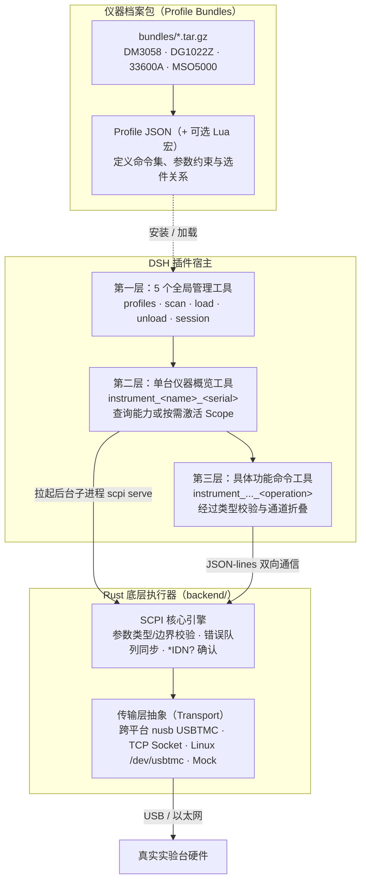

# 电子工程师大肥鱼 · ee-fat-whale

> 让大语言模型安全、听话地控制你的实验室硬件，把杂乱的仪器指令变成结构化的专业工具。

**电子工程师大肥鱼（ee-fat-whale）** 是专为电子工程师打造的 DeepSeek Harness (DSH) 插件。它的核心使命很简单：**把真实的 SCPI 测量仪器接入大模型，同时保证硬件安全与上下文效率。**

在传统做法中，如果直接让 LLM 随意拼凑并发送裸 SCPI 字符串，不仅极易产生语法幻觉、搞崩仪器通信队列，还可能因为输错电压量程或漏关通道输出而直接烧毁待测板卡。此外，一台现代示波器往往有上千条 SCPI 指令，把它们全铺进上下文会瞬间吃满几十万 tokens，导致大模型处理缓慢甚至直接罢工。

本项目通过**双层架构 + 仪器档案包**彻底解决了这些问题：
- **Rust 底层执行器**：坚守协议底线，负责严格的类型与范围校验、SCPI 语法拼装、响应解析、仪器错误队列监控，以及跨平台的 USB/TCP 硬件通信。
- **DSH 插件宿主**：负责管理仪器档案包、会话生命周期、设置页面交互，并动态向大模型按需派发工具。
- **可插拔仪器包**：具体的仪器命令表、选件探测、能力分组、通道定义和安全联锁完全由独立的 Profile 描述，增减仪器无需重新编译底层。
- **绝对不向大模型暴露裸 SCPI**：模型只能看到经过参数校验与逻辑抽象的强类型工具（Typed Tools），从根本上避免“胡说八道发错指令”。

项目开箱内置了 **Rigol DM3058**（数字万用表）、**Rigol DG1022Z**（函数发生器）、**Keysight 33600A**（波形发生器）以及 **Rigol MSO5000**（混合信号示波器）四个常用仪器包，在设置页一键即可安装使用。

---

## 核心设计亮点

- **按需加载（basic → instrument → tools 三层渐进展开）**  
  不会开局就给模型硬塞上千个工具。一开始只有基础管理工具；连上仪器后只暴露仪器概览工具；模型需要调节通道或测量时，才按需激活对应的功能分组（Scope）。上下文从几十万 tokens 骤降至几千 tokens。
- **按能力分组，而非死板地按物理通道拆分**  
  把功能按工程直觉拆分为 `vertical`（垂直系统）、`waveform`（波形发生）、`trigger`（触发）、`measure`（测量）、`modulation`（调制）等逻辑能力组。
- **智能通道折叠（Channel Folding）**  
  示波器的 4 个通道无需生成 4 组完全相同的工具。系统自动把 `ch1.scale` 到 `ch4.scale` 合并为一个带有 `channel: 1..4` 参数的 `vertical_scale` 工具；对于单通道仪器，系统还会贴心地自动隐藏 channel 参数，避免冗余。
- **严格的双层参数类型化校验**  
  所有参数均带有强类型约束（`bool` / `int` / `float` / `string` / `enum` / `any`），配备明确的 `min`、`max` 和枚举值列表。插件层先拦截一次非法输入，Rust 执行器在真正发往硬件前再严密校验一次。
- **硬件输出安全联锁（Safety Output）**  
  调节发生器输出幅度或偏置时，最忌讳带载跳变。引擎支持声明安全联锁：在下发修改指令前由 Rust 强制关闭输出，写入成功后再稳妥开启；一旦写入失败则保持关闭，保护现场电路。
- **选件自适应（Option Aware）**  
  连上仪器后自动探测已装硬件选件（如示波器的 AWG 发生器、协议解码等）。未购买或未启用的选件所对应的指令绝对不会暴露给模型，MSO 的复合选件包（如 `BND`）也能正确识别隐含依赖。
- **经得起考验的手册级审计**  
  MSO5000 的全部 889 条命令均逐条对照官方中文编程手册人工核验，记录了每一条指令的合法性与边界，详见 [audit/mso5000-audit.md](audit/mso5000-audit.md)。
- **精打细算的 Token 消耗**  
  日常连接 4 台仪器的概览工具仅耗费约 1.6k tokens；激活日常推荐的测量/波形 scope 仅耗费约 54.7k tokens，完美适配常见模型的上下文窗口，详见 [audit/tool-token-usage.md](audit/tool-token-usage.md)。

---

## 支持的仪器清单

| 仪器型号 | 仪器类型 | Profile ID | 附带安装包 | 模拟通道 | 原始命令数 | 逻辑工具数 | 日常推荐 Scope |
| --- | --- | --- | --- | ---: | ---: | ---: | --- |
| **Rigol DM3058 / DM3058E** | 5½ 位数字万用表 | `rigol.dm3058` | `dm3058.tar.gz` | 0 | 126 | 126 | `measure` |
| **Rigol DG1022Z** | 双通道函数/任意波形发生器 | `rigol.dg1022z` | `dg1022z.tar.gz` | 2 | 382 | 255 | `waveform` |
| **Keysight 33600A / 33611A** | 80/120MHz 波形发生器 | `keysight.33600a` | `ks33600a.tar.gz` | 1 | 382 | 252 | `waveform` |
| **Rigol MSO5000**（全选件） | 混合信号示波器 | `rigol.mso5000` | `mso5000.tar.gz` | 4 | 889 | 856 | `vertical`, `horizontal`, `trigger`, `measure` |

> *注：逻辑工具数是经过 channel 折叠后的实际工具量。例如 MSO5000 在仅开启 AWG 选件时是 614 个逻辑工具，全部 9 个选件全开时是 856 个。*

预编译发行包完整覆盖 6 个主流 64 位操作系统及架构：

| 操作系统 | CPU 架构 | 预编译二进制 | CI 构建镜像 |
| --- | --- | --- | --- |
| Linux | x86_64 | `bin/scpi` | `ubuntu-22.04` |
| Linux | ARM64 | `bin/scpi` | `ubuntu-22.04-arm` |
| macOS | Intel (x86_64) | `bin/scpi` | `macos-15-intel` |
| macOS | Apple Silicon (arm64) | `bin/scpi` | `macos-14` |
| Windows | x86_64 | `bin/scpi.exe` | `windows-latest` |
| Windows | ARM64 | `bin/scpi.exe` | `windows-11-arm` |

---

## 整体架构与工作流



**清晰的责任边界：**
- **Rust 执行器**内部完全是通用的，不写死任何特定仪器的私有逻辑。启动时必须通过 `--profile` 载入具体的 Profile 配置文件。
- **插件端**专注于上下文管理与用户交互，完全不碰底层的裸 SCPI 字节流，所有通讯都通过结构化的 JSON-lines 管道与 Rust 子进程交互。

### 支持的硬件传输协议

| 传输格式 | 说明与典型场景 |
| --- | --- |
| `usb:<vid>:<pid>[:<serial>]` | 跨平台原生 USBTMC（基于 nusb，免安装臃肿驱动），`instrument_scan` 自动发现输出的格式 |
| `tcp://host:port` | 原始 SCPI 网络套接字，适用于通过网线直连或局域网连接的仪器（端口号请参考各型号手册） |
| `usbtmc:/dev/usbtmcN` | Linux 系统原生内核的 `/dev/usbtmc*` 字符设备接口 |
| `mock` / `mock:<responses.json>` | 纯软件模拟测试模式，无需硬件即可进行完整链路演练与调试 |

---

## 安装指引

### 环境要求

- 已安装并运行 DeepSeek Harness (DSH) Web 版或 Desktop 版（带插件管理与设置页面）。
- 如果直接使用发布的**平台发行包**，无需安装额外的 Node 或 Rust 依赖，解压即用。
- 只有从**源码构建**时，才需要本地安装 Rust (1.80+) 工具链。
- USB 连接需要相应的系统底层通信权限（详见下文 USB 权限说明）。

### 方法一：从预编译发行包安装（推荐）

从 GitHub Releases 页面下载适合你操作系统的压缩包：

```text
ee-fat-whale-v0.1.0-linux-x64.tar.gz
ee-fat-whale-v0.1.0-linux-arm64.tar.gz
ee-fat-whale-v0.1.0-darwin-x64.tar.gz
ee-fat-whale-v0.1.0-darwin-arm64.tar.gz
ee-fat-whale-v0.1.0-win32-x64.zip
ee-fat-whale-v0.1.0-win32-arm64.zip
```

解压后将得到完整的插件目录结构：

```text
ee-fat-whale/
├── index.js          # 插件入口
├── bin/scpi          # 预编译好的底层执行器（Windows 为 scpi.exe）
├── bundles/          # 默认附带的 4 款仪器安装包
└── ...
```

在 DSH 的“插件管理”界面中，选择**安装本地 Bundle**，选中解压后的 `ee-fat-whale/` 目录；或者也可以让 AI Agent 执行：

```text
plugin_manager(action: "install_bundle", target: "/你的绝对路径/ee-fat-whale")
```

### 方法二：从源码构建安装

如果你想自行修改 Rust 核心或自定义功能，可以从源码快速编译：

```bash
git clone <repository-url>
cd ee-fat-whale/backend
cargo build --release
mkdir -p ../bin
cp target/release/scpi ../bin/scpi
```

如果是 Windows PowerShell 环境：

```powershell
cd ee-fat-whale\backend
cargo build --release
New-Item -ItemType Directory -Force ..\bin | Out-Null
Copy-Item target\release\scpi.exe ..\bin\scpi.exe
```

构建完成后，`bin/` 目录下将生成当前系统可执行的二进制文件。随后同样在 DSH 中把插件目录作为本地插件加载即可。

### 启用与就绪检查

1. 在 DSH 插件列表中勾选启用 **电子工程师大肥鱼**。
2. 刷新界面，在 Settings（设置）侧边栏中可以看到本插件的独立设置项。
3. 进入设置页，确认 Profile 列表能够正常展示；如果上方提示未找到执行器，请检查 `bin/scpi`（或 `bin/scpi.exe`）是否存在且具备可执行权限。
4. 你也可以在对话中调用 `instrument_profiles(action: "list")` 来核验当前已安装的仪器档案。

### 操作系统 USB 通信权限配置

- **Linux**：默认情况下普通用户可能无权直接读写原始 USB 设备。建议在 `/etc/udev/rules.d/99-usbtmc.rules` 中为 Rigol / Keysight 的 VID（如 `1ab1`、`0957`、`2a8d`）添加 `MODE="0666"` 规则，并运行 `sudo udevadm control --reload-rules`。
- **Windows**：底层 nusb 通过 WinUSB 通信。如果仪器出厂默认是专用驱动，可以用 Zadig 工具将该 USBTMC 设备接口替换为 WinUSB 或 libusbK 驱动。
- **macOS**：初次运行接入硬件时，系统会弹出权限请求提示，允许 DSH 或终端访问 USB 设备即可。
- 连接好仪器后，先运行一次 `instrument_scan` 确认系统能否正确发现硬件。

### 更新与卸载

- **升级插件**：直接用新版本的发行包替换现有目录并重新加载插件即可。你导入的自定义仪器档案存放在用户家目录的 `~/.dsh/ee-fat-whale/profiles` 下，不会被覆盖弄丢。
- **卸载插件**：在 DSH 插件管理页禁用或删除插件。如需彻底清除本地所有历史配置与 Profile，手动删除 `~/.dsh/ee-fat-whale/` 目录即可。

---

## 快速上手（五步走）

大模型或开发者控制仪器的完整流程非常清晰：

### 第一步：安装所需的仪器包

在设置页面可以直接点击内置的仪器安装，或者在对话中调用工具：

```json
instrument_profiles {"action": "install_bundled", "name": "mso5000"}
```

*（该工具还支持 `list` 查看、`install_bundle` 导入外部压缩包、`remove` 移除等操作）*

### 第二步：扫描并加载设备

调用扫描工具：

```json
instrument_scan {}
```

系统会枚举所有的 USBTMC 设备，并自动和已安装的 Profile 关联匹配，返回类似结果：

```json
{
  "resource": "usb:1ab1:0515:MS5A222402148",
  "profile_id": "rigol.mso5000"
}
```

随后调用加载工具建立连接：

```json
instrument_load {
  "resource": "usb:1ab1:0515:MS5A222402148",
  "profile_id": "rigol.mso5000"
}
```

此时系统只会在上下文中注册一个**单台仪器管理工具**，几乎不占用任何 tokens：

```json
{
  "instrument_tool": "instrument_mso5000_ms5a222402148",
  "channels": 4,
  "tool_count": 0,
  "selected_capabilities": []
}
```

### 第三步：按需激活功能分组（Scope）

先无参调用该工具查看该设备支持的所有功能：

```json
instrument_mso5000_ms5a222402148 {}
```

模型会看到该示波器具备 `vertical`、`horizontal`、`trigger`、`measure` 等能力，接着根据当前实验任务激活所需分组：

```json
instrument_mso5000_ms5a222402148 {
  "capabilities": ["vertical", "horizontal", "measure"]
}
```

只有在这一刻，系统才会精准注册相关的具象控制工具（如 `..._vertical_scale`、`..._timebase_scale` 等）。

### 第四步：安全调用具体命令

例如将通道 2 的垂直偏置/档位调整为 500mV/div：

```json
instrument_mso5000_ms5a222402148_vertical_scale {
  "channel": 2,
  "v": 0.5
}
```

该工具在底层会被严密校验后翻译为 `:CHANnel2:SCALe 0.5` 发送给示波器。

如果是单通道发生器（如 33600A 单通道模式），工具中完全不需要传递 `channel`，直接设定参数：

```json
instrument_keysight33600a_my53300226_waveform_frequency {
  "hz": 1000000
}
```

### 第五步：实验完毕，安全卸载

实验结束后，一键注销工具并释放物理连接：

```json
instrument_unload {"session_id": "scpi-1"}
```

系统会注销该仪器注册的所有动态工具，并优雅终止与底层的通讯子进程。

---

## 深入机制：三层工具模型

为了在工具完备性与大模型上下文容量之间取得平衡，我们建立了三层架构：

### 第一层：全局管理工具（5 个静态工具）

这 5 个工具全局常驻，负责设备发现与会话调度：
- `instrument_profiles`：列出、导入、安装和删除仪器档案包。
- `instrument_scan`：快速扫描 USB 物理总线，按 VID/PID 自动匹配支持的仪器。
- `instrument_load`：开启/复用硬件会话，注册第二层的仪器工具。
- `instrument_unload`：注销指定仪器及其下属所有命令工具，关闭硬件会话。
- `instrument_session`：供高级排错使用的低级会话管理（open / list / close）。

### 第二层：单台仪器概览工具（动态实例）

每台成功加载的物理仪器都会生成一个专属的二级管理工具，命名格式为：
`instrument_<工具前缀>_<序列号>`（例如 `instrument_mso5000_ms5a222402148`）。

它就像该设备的遥控总闸：
- **无参调用**：查询当前设备的基本参数、通道数量、可选的能力分组（Scope）以及当前已激活状态。
- **传递 `capabilities: [...]`**：动态注册或切换第三层的具体命令工具。例如传 `["vertical", "measure"]` 只展开这两组工具；传 `["*"]` 展开所有工具；传 `[]` 则收回所有命令工具但保持物理连接不断开。

### 第三层：具体业务命令工具（按需展开）

第三层工具是模型实际用来操作仪器的手脚，命名格式为：
`instrument_<工具前缀>_<序列号>_<逻辑操作名>`。

例如：
- `instrument_mso5000_ms5a222402148_vertical_scale`（调节示波器垂直档位）
- `instrument_dg1022z_dg1za251000776_waveform_frequency`（调节信号源输出频率）
- `instrument_dm3058_dm3r251000551_meas_vdc`（万用表直流电压测量）

---

## 智能通道折叠（Channel Folding）机制

在传统做法中，如果示波器有 4 个通道，命令表往往是四份重复定义：`ch1.scale`、`ch2.scale`、`ch3.scale`、`ch4.scale`。如果机械地把它们全部变成工具，不仅极度浪费 token，还会让大模型产生混乱。

本插件采用了**语义通道折叠算法**：

```text
ch1.scale + ch2.scale + ch3.scale + ch4.scale
                      ↓
合并为一个逻辑工具：
vertical_scale { channel: 1..4, v: number }
```

- **多通道设备（`channels > 1`）**：自动合并同名指令，增加一个必填的 `channel` 参数，取值范围限定在 `1..N`。
- **单通道设备（`channels == 1`）**：自动省略 `channel` 参数，模型下发参数时内部自动映射为 `ch1`，省去模型多写一步的负担。
- **无通道概念设备（`channels == 0`，如万用表）**：同样不会出现 `channel` 参数。
- **一致性保护**：只有当多个通道的参数类型、范围、读写属性完全一致时才会合并；一旦出现某通道特有的特殊属性，系统会自动退回为独立工具，确保指令绝对安全。

**读写调用体验示例：**

```json
{"channel": 2}          // 查询通道 2 的垂直档位
{"channel": 2, "v": 0.5} // 将通道 2 的垂直档位设置为 0.5V
{"v": 0.5}              // 错误：缺少必填的 channel 参数，直接被本地拦截
```

---

## 严密的安全保障与参数校验

真实仪器的物理输出极其严肃，容不得半点失误。系统在每一层都筑起了防线：

### 参数强类型 Schema 映射

Profile 中的参数严格映射为标准的 JSON Schema：
- `bool` → `boolean`
- `int` → `integer`（配备精确的 `minimum` / `maximum` 范围限制）
- `float` → `number`（配备精确的数值范围限制）
- `enum` → `string`（受限于预设合法枚举值）
- `string` → `string`（必要时自动转义双引号）
- `any` → `oneOf` 基础类型（保留部分特殊原样 token，如 `MIN`, `MAX`, `DEF`）

每次工具调用时，前端插件先做一层 Schema 拦截；数据传到 Rust 后，执行器会严格按照物理量程和规约再做一次底线校验。

### 输出安全联锁（Safety Output）

在信号发生器等源类设备中，直接带电切换频率、波形或大幅度电压极易在端口产生危险瞬态尖峰。Profile 中可对敏感指令标记 `safety_output: "ch1.output"`。  
当模型尝试修改该参数时，**Rust 执行器会自动在底层执行“三部曲”：先关闭输出端口 → 下发新参数 → 校验硬件状态成功后再重新开启输出**。如果新参数下发过程中发生任何异常，输出端口将保持关闭状态，彻底杜绝炸板风险。

---

## 仪器档案包结构（Profile Bundle）

仪器包是结构清晰的独立压缩归档（支持 `.tar.gz`、`.tgz`、`.zip`）。每个包内包含：
1. **一个核心 Profile JSON 文件**：完整描述该仪器的元数据、通信要求、命令映射集。
2. **可选的一个 Lua 脚本文件**：用于封装需要仪器往返判断的高级宏逻辑。
3. **安全防范**：解包过程严格防范软链接穿越、路径跨目录攻击以及恶意文件。

### Profile 顶层核心字段一览

```json
{
  "schema_version": 1,
  "id": "rigol.mso5000",
  "name": "Rigol MSO5000",
  "manufacturer": "Rigol Technologies",
  "idn_match": ["MSO5000"],
  "usb": { "vid": "1ab1", "pid": "0515" },
  "terminator": "\n",
  "timeout_ms": 10000,
  "channels": 4,
  "tool_name": "mso5000",
  "capabilities": [ ... ],
  "default_capabilities": ["vertical", "horizontal", "trigger", "measure"],
  "commands": [ ... ]
}
```

### 单条命令定义示例

```json
{
  "id": "ch1.scale",
  "header": ":CHANnel1:SCALe",
  "summary": "通道垂直灵敏度档位",
  "writable": true,
  "readable": true,
  "args": [
    { "name": "v", "type": "float", "min": 0.001, "max": 10 }
  ],
  "result": "float"
}
```

- `header` 为写入命令字，如果是读命令且没有特别声明 `query_header`，引擎默认会在末尾追加 `?` 进行查询。
- 选件约束：通过 `requires: ["AWG"]` 可以与仪器实测选件绑定，无选件时不予暴露。
- 允许通过 `special: ["MIN", "MAX"]` 放行常用 SCPI 边界关键字。

---

## 实测 Token 预算与开销控制

在大模型实际应用中，Token 预算就是生命线。我们在 DeepSeek Tokenizer 下针对 4 台真实仪器进行了严格实测：

| 加载深度 | 包含内容 | 工具总数 | 消耗 Tokens（原生） | 消耗 Tokens（包装后） |
| --- | --- | ---: | ---: | ---: |
| **仅第二层（Level-2）** | 5 个基础管理 + 4 台仪器概览工具 | 9 | **1,608** | **1,662** |
| **激活推荐 Scope** | 展开日常最常用的垂直/波形/测量等组 | 403 | **54,734** | **57,152** |
| **暴力全量加载** | 将 4 台仪器全部 1400+ 逻辑命令一股脑全展开 | 1,498 | **193,907** | **202,895** |

**工程师思考：**
- 传统无脑平铺所有工具的做法，光是 System Prompt 中的 Tool 定义就会吞噬接近 **20 万 tokens**，直接打穿大部分模型的性能甜点区。
- 本插件的“推荐 Scope”策略成功将 4 台专业仪器的日常核心工具压制在 **5.4 万 tokens** 以内，完全在 64k 的安全水位线内。
- 默认状态下只有不到 **1.6k tokens**，日常待命几乎零负担。

---

## 本地构建与打包

项目使用标准 Rust 与 Node.js 现代工具链。

### 本地编译底层二进制

仓库不直接跟踪构建后的 `bin/` 产物。本地改动了 Rust 源码后，运行以下命令即可：

```bash
cd backend
cargo build --release
cp target/release/scpi ../bin/scpi
```

*(Windows 环境对应 `target/release/scpi.exe`)*

### 运行打包脚本

按照当前操作系统打包插件压缩包：

```bash
npm run package
```

构建脚本会自动抓取平台二进制与必要的前端、规则资源，并在 `dist/` 目录下生成用于分发的归档文件与 `.sha256` 校验和。

---

## 测试验证与手册审计

我们对可靠性有着严苛的要求：

```bash
# 运行后端单元测试与 Mock 回归测试
cd backend
cargo test
cargo clippy --all-targets

# 运行前端轻量渲染测试（验证 UI 组件稳定性）
npm run test:client
```

- **全面测试覆盖**：涵盖了 SCPI 长短格式辨识、参数边界截断、双引号字符转义、`*IDN?` 校验、错误队列轮询、Lua 宏调用与死锁规避。
- **极端硬件行为适配**：以 Keysight 33600A 为代表的“严苛型”仪器（不能投机读取、上一条查询未消费前严禁发送下一条、严禁无故清空输入缓冲区），都在核心引擎层通过状态机进行了完整保障。
- **手册逐条核验**：MSO5000 的 889 条命令均与官方《编程指南》逐行核对，见 [audit/mso5000-audit.md](audit/mso5000-audit.md)。

---

## 项目目录一览

```text
ee-fat-whale/
├── index.js                 # 插件核心入口（服务注册与生命周期）
├── client.js                # DSH 设置中心前端渲染脚本
├── host/                    # Node.js 宿主端逻辑实现
│   ├── profiles.js          # 仪器档案管理、目录存储与设置同步
│   ├── archive.js           # 仪器包（tar.gz/zip）安全解压与结构校验
│   ├── session.js           # Rust 后台子进程生命周期与 JSON-lines 通信
│   ├── discover.js          # USB 总线枚举与 VID/PID 自动匹配
│   ├── instruments.js       # 三层工具生成、通道智能折叠与 Scope 管理
│   ├── tools.js             # 注册 5 个全局基础管理工具
│   └── routes.js            # 提供给设置界面的内部 HTTP 接口
├── bundles/                 # 随附的官方仪器档案包（DM3058 / DG1022Z / 33600A / MSO5000）
├── backend/                 # 核心 Rust Workspace
│   ├── crates/scpi-core/    # 通用 SCPI 协议引擎、硬件抽象与类型解析
│   └── crates/scpi-cli/     # 独立命令行工具 & serve 服务端
├── audit/                   # 官方手册审计报告与 Token 消耗实测表
├── scripts/package.mjs      # 跨平台自动化打包发布脚本
├── locale/                  # 多语言展示文本
└── icon.png                 # 插件图标
```

---

## 当前已知边界与开发计划

为了让使用者心中有数，这里坦诚列出当前系统的边界：
1. **暂不支持二进制波形大数据块（IEEE 488.2 `#<len>` 数据块）**：示波器的大容量原始深存储波形导出、发生器的大型任意波点阵下发以及屏幕截图位图导出功能仍在规划中。
2. **网络通信当前仅支持 Raw Socket**：通过网线连接仪器时使用 `tcp://ip:port`，目前尚未集成复杂的 VXI-11 / HiSLIP 握手协议。
3. **局域网设备暂不自动扫描**：自动发现（Scan）目前专注于免驱动的 USBTMC 总线扫描，局域网仪器需手动指定 IP 连接。
4. **大模型 Token 控制建议**：虽然提供了 `["*"]` 一键拉满全量工具的选项，但面对 MSO5000 这类巨无霸设备时，依然建议根据任务按需激活对应的 Scope。

---

## 许可证

待定（未添加正式 LICENSE 标识前保留所有权利）。
