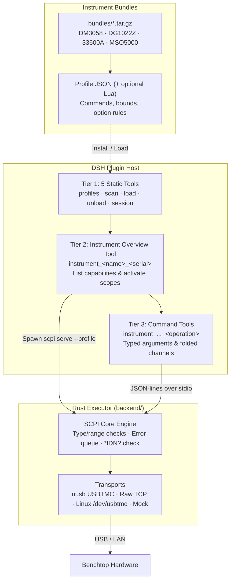

<p align="center">
  
</p>

# EE Fat Whale · ee-fat-whale

<p align="center">
  <a href="README.md">简体中文</a> | <b>English</b>
</p>

`ee-fat-whale` is a DeepSeek Harness (DSH) plugin for controlling SCPI laboratory instruments from an LLM.

Letting a model emit raw SCPI strings directly is error-prone: typos clog the instrument error queue, out-of-range parameters or live output changes can damage a board under test, and dumping hundreds of oscilloscope commands into the prompt at once consumes nearly 200k tokens.

This project splits the work between a generic Rust backend and a JavaScript plugin host:
- **Rust Backend (`backend/`)**: Handles USBTMC/TCP I/O, argument type and range validation, SCPI framing, response parsing, error queue polling, and output safety interlocks. No instrument-specific commands are hardcoded in Rust.
- **DSH Plugin Host (`host/`)**: Manages profile bundles and subprocess sessions, exposing typed tools to the model in three tiers (`basic` → `instrument` → `tools`). Raw SCPI is never exposed to the model.
- **Profile Bundles (`bundles/`)**: Instrument command tables, option probes, channel counts, and `safety_output` policies live in standalone JSON profiles (with optional Lua scripts). Supporting a new instrument only requires a new profile bundle.

Four instrument bundles are included: **Rigol DM3058**, **Rigol DG1022Z**, **Keysight 33600A**, and **Rigol MSO5000**.

---

## Key Features

- **Three-Tier Tool Loading (`basic` → `instrument` → `tools`)**  
  Starts with 5 static management tools. Loading an instrument adds a single overview tool. Concrete command tools are registered only when the model activates specific capability scopes.
- **Capability Scopes**  
  Commands are grouped by function (`vertical`, `waveform`, `trigger`, `measure`, `modulation`, etc.) rather than by physical channel.
- **Channel Folding**  
  Symmetric per-channel commands like `ch1.scale` .. `ch4.scale` are folded into a single `vertical_scale` tool with a `channel: 1..4` parameter. Single-channel instruments omit the `channel` parameter automatically.
- **Two-Layer Argument Validation**  
  Arguments use explicit types (`bool`, `int`, `float`, `string`, `enum`, `any`) and `min`/`max` bounds, checked in the JS host and enforced again in the Rust backend before writing to the bus.
- **Output Interlocks (`safety_output`)**  
  Commands marked with `safety_output` automatically turn the corresponding output channel off before writing and turn it back on only if the write succeeds.
- **Option Probing**  
  Installed hardware options (including composite bundles like `BND` on the MSO5000) are queried when an instrument is loaded; commands requiring missing options are hidden.
- **Manual Audit & Token Benchmarks**  
  All 889 MSO5000 commands were checked against the programming manual ([audit/mso5000-audit.md](audit/mso5000-audit.md)). Token measurements across all 4 instruments are documented in [audit/tool-token-usage.md](audit/tool-token-usage.md).

---

## Supported Instruments

| Instrument | Type | Profile ID | Bundle | Channels | Raw Commands | Logical Tools | Default Scopes |
| --- | --- | --- | --- | ---: | ---: | ---: | --- |
| **Rigol DM3058 / DM3058E** | 5½ digit DMM | `rigol.dm3058` | `dm3058.tar.gz` | 0 | 126 | 126 | `measure` |
| **Rigol DG1022Z** | Dual-channel AWG | `rigol.dg1022z` | `dg1022z.tar.gz` | 2 | 382 | 255 | `waveform` |
| **Keysight 33600A / 33611A** | Waveform generator | `keysight.33600a` | `ks33600a.tar.gz` | 1 | 382 | 252 | `waveform` |
| **Rigol MSO5000** (all options) | Mixed-signal oscilloscope | `rigol.mso5000` | `mso5000.tar.gz` | 4 | 889 | 856 | `vertical`, `horizontal`, `trigger`, `measure` |

> Logical tool counts reflect channel folding. On the MSO5000, enabling only the AWG option exposes 614 logical tools; enabling all 9 options exposes 856.

Precompiled release archives are built for 6 platforms:

| OS | Architecture | Binary Path | CI Runner |
| --- | --- | --- | --- |
| Linux | x86_64 | `bin/scpi` | `ubuntu-22.04` |
| Linux | ARM64 | `bin/scpi` | `ubuntu-22.04-arm` |
| macOS | x86_64 | `bin/scpi` | `macos-15-intel` |
| macOS | arm64 | `bin/scpi` | `macos-14` |
| Windows | x86_64 | `bin/scpi.exe` | `windows-latest` |
| Windows | ARM64 | `bin/scpi.exe` | `windows-11-arm` |

---

## Architecture



### Supported Transports

| Transport Spec | Description |
| --- | --- |
| `usb:<vid>:<pid>[:<serial>]` | Cross-platform USBTMC via `nusb` (no VISA installation required). Returned by `instrument_scan`. |
| `tcp://host:port` | Raw SCPI over TCP (typically port 5025 or 5555; check the instrument manual). |
| `usbtmc:/dev/usbtmcN` | Linux kernel USBTMC character device. |
| `mock` / `mock:<responses.json>` | In-memory mock transport for tests and offline use. |

---

## Installation

### Requirements

- DeepSeek Harness (DSH) Web or Desktop.
- Precompiled release archives require no external Node or Rust toolchain.
- Building from source requires Rust 1.80+.

### Option 1: Precompiled Release Archive

Download the archive for your platform from GitHub Releases:

```text
ee-fat-whale-v0.1.0-linux-x64.tar.gz
ee-fat-whale-v0.1.0-linux-arm64.tar.gz
ee-fat-whale-v0.1.0-darwin-x64.tar.gz
ee-fat-whale-v0.1.0-darwin-arm64.tar.gz
ee-fat-whale-v0.1.0-win32-x64.zip
ee-fat-whale-v0.1.0-win32-arm64.zip
```

Extract the archive and install the `ee-fat-whale/` directory via **Install Local Bundle** in DSH Plugin Management, or run:

```text
plugin_manager(action: "install_bundle", target: "/absolute/path/to/ee-fat-whale")
```

### Option 2: Build from Source

```bash
git clone <repository-url>
cd ee-fat-whale/backend
cargo build --release
mkdir -p ../bin
cp target/release/scpi ../bin/scpi
```

On Windows PowerShell:

```powershell
cd ee-fat-whale\backend
cargo build --release
New-Item -ItemType Directory -Force ..\bin | Out-Null
Copy-Item target\release\scpi.exe ..\bin\scpi.exe
```

Then load the repository root as a local bundle in DSH.

### USB Permissions

- **Linux**: Add a udev rule (e.g. `/etc/udev/rules.d/99-usbtmc.rules`) setting `MODE="0666"` for your instrument's USB VID (`1ab1`, `0957`, `2a8d`, etc.) and run `sudo udevadm control --reload-rules`.
- **Windows**: `nusb` uses WinUSB. If a vendor driver is bound to the device, use Zadig to switch the USBTMC interface to WinUSB or libusbK.
- **macOS**: Allow DSH/terminal access when prompted on first connection.

---

## Quickstart

### 1. Install an Instrument Bundle

Click **Install** in the Settings page or call:

```json
instrument_profiles {"action": "install_bundled", "name": "mso5000"}
```

### 2. Scan and Load

Enumerate connected USBTMC devices:

```json
instrument_scan {}
```

Load the matched device:

```json
instrument_load {
  "resource": "usb:1ab1:0515:MS5A222402148",
  "profile_id": "rigol.mso5000"
}
```

This registers only the level-2 overview tool (`instrument_mso5000_ms5a222402148`) with `tool_count: 0`.

### 3. Activate Capability Scopes

Call the overview tool with no arguments to inspect available scopes:

```json
instrument_mso5000_ms5a222402148 {}
```

Pass `capabilities` to register the level-3 command tools for those scopes (or `["*"]` for all):

```json
instrument_mso5000_ms5a222402148 {
  "capabilities": ["vertical", "horizontal", "measure"]
}
```

### 4. Run Commands

Set CH2 vertical scale to 500 mV/div (`:CHANnel2:SCALe 0.5`):

```json
instrument_mso5000_ms5a222402148_vertical_scale {
  "channel": 2,
  "v": 0.5
}
```

For single-channel instruments, `channel` is omitted:

```json
instrument_keysight33600a_my53300226_waveform_frequency {
  "hz": 1000000
}
```

### 5. Unload

Close the backend session and unregister all dynamic tools for the instrument:

```json
instrument_unload {"session_id": "scpi-1"}
```

---

## Token Usage

Measured with the DeepSeek tokenizer across all 4 bundled instruments (all options enabled; see [audit/tool-token-usage.md](audit/tool-token-usage.md)):

| Stage | Tools Registered | Tool Count | Native Tokens | OpenAI-Wrapped Tokens |
| --- | --- | ---: | ---: | ---: |
| **Tier 2 Standby** | 5 basic tools + 4 instrument overview tools | 9 | **1,608** | **1,662** |
| **Recommended Scopes** | `default_capabilities` on all 4 instruments | 403 | **54,734** | **57,152** |
| **Full Activation (`["*"]`)** | All logical tools across all 4 instruments | 1,498 | **193,907** | **202,895** |

---

## Project Layout

```text
ee-fat-whale/
├── index.js                 # Plugin entry point
├── client.js                # DSH Settings UI component
├── host/
│   ├── profiles.js          # Profile store and settings persistence
│   ├── archive.js           # In-memory bundle extraction and validation
│   ├── session.js           # Subprocess lifecycle and JSON-lines IPC
│   ├── discover.js          # USBTMC enumeration and profile matching
│   ├── instruments.js       # Tier 2/3 tool registration, option probing, channel folding
│   ├── tools.js             # 5 static management tools
│   └── routes.js            # HTTP endpoints for the settings UI
├── bundles/                 # Bundled profiles (DM3058 / DG1022Z / 33600A / MSO5000)
├── backend/
│   ├── crates/scpi-core/    # SCPI engine, type system, Lua runtime, transports
│   └── crates/scpi-cli/     # `scpi` CLI and `scpi serve` stdio daemon
├── audit/                   # Manual audit notes and token benchmarks
├── scripts/package.mjs      # Release archive packaging script
└── locale/                  # Localization metadata (zh/en)
```

---

## Current Limitations

1. **No IEEE 488.2 `#<len>` binary block transfers yet**: raw waveform memory dumps, arbitrary waveform point uploads, and display bitmap captures are not yet supported.
2. **Raw TCP sockets only for LAN**: uses `tcp://ip:port`; VXI-11 and HiSLIP are not implemented.
3. **USB-only auto-discovery**: `instrument_scan` enumerates USBTMC devices; LAN instruments must be loaded by IP.

---

## License

Licensed under the **GNU Affero General Public License v3.0 (AGPL-3.0-or-later)**. See [LICENSE](LICENSE) for the full text.

- If you modify this software and run it as a network service, you must make the modified source code available to users of that service.
- User-supplied Profile JSON files and external Lua scripts loaded dynamically at runtime are treated as configuration data and are not subject to AGPL v3 copyleft requirements.
